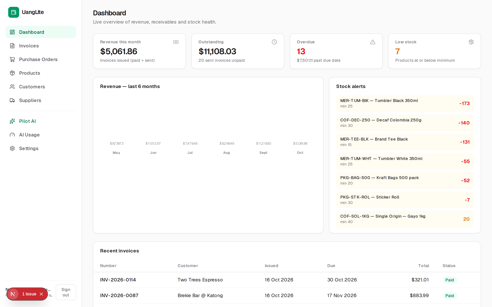
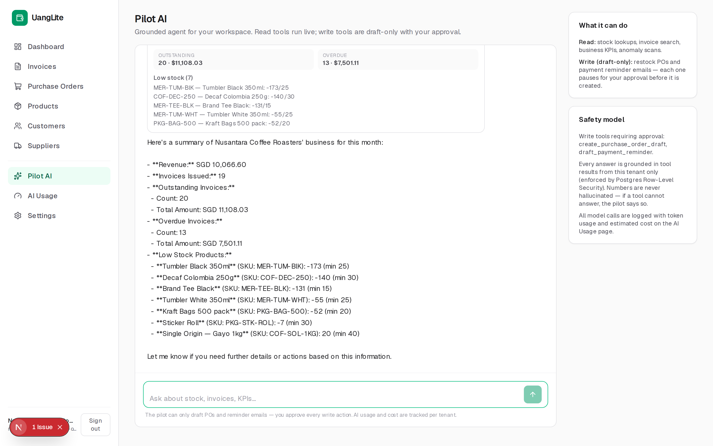
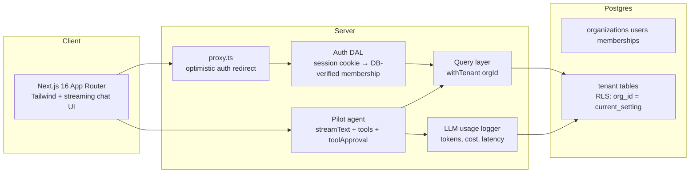

# UangLite — a mini-ERP with an AI pilot

**Live demo: [uanglite.ricothen.com](https://uanglite.ricothen.com)** · sign in with `demo@uanglite.dev` / `demo1234`

|  |
|:--:|
| *Dashboard — revenue, receivables, stock alerts from 120+ seeded transactions* |

**Inventory, invoicing and purchasing — with an LLM agent that doesn't just answer questions, but drafts the work:** restock purchase orders and payment-chasing emails, each gated behind explicit human approval.

|  |
|:--:|
| *The Pilot answering a business question with `business_summary` — every number comes from a tool call* |

> Inspired by [uang.ai](https://uang.ai) ("The AI Factory") and their mission of pairing deep business understanding with agentic AI. This project is a self-contained demonstration of exactly that stack: a multi-tenant business application where an LLM agent operates on real data, safely.

---

## Demo

**Production:** [uanglite.ricothen.com](https://uanglite.ricothen.com) (Vercel + Neon Postgres) · [Help & FAQ](https://uanglite.ricothen.com/faq)

The UI ships with a light/dark theme toggle (follows `prefers-color-scheme` on first visit, persisted per browser) and inline tooltips explaining every business metric and status.

Run it yourself:

```bash
docker compose up --build
# open http://localhost:3000
```

| Account | Tenant | Role |
|---|---|---|
| `demo@uanglite.dev` | Nusantara Coffee Roasters | owner |
| `staff@uanglite.dev` | Nusantara Coffee Roasters | staff |
| `surf@uanglite.dev` | Bali Surf Supplies | owner |
| `outdoor@uanglite.dev` | Kinabalu Outdoor Co. | owner |

Password for all demo accounts: `demo1234`

For the AI pilot set `LLM_API_KEY` (any OpenAI-compatible endpoint works — OpenAI, Together, OpenRouter, a local vLLM). Without a key the ERP works fully and the pilot returns a clear "not configured" response.

## What the pilot can do

| Tool | Type | What it does |
|---|---|---|
| `query_stock` | read | Stock levels per SKU, low-stock lists |
| `query_invoices` | read | Search invoices by status / overdue |
| `business_summary` | read | Revenue, receivables, overdue, low stock KPIs |
| `detect_anomalies` | read | Negative stock, 30+ day overdue aging, invoice totals that don't match their lines |
| `query_suppliers` | read | Supplier directory with PO counts, open POs, ordered value and the products each supplier provides |
| `query_customers` | read | Customer directory with invoiced, outstanding and overdue totals per customer |
| `query_purchase_orders` | read | PO list with status filters and late-arrival flags |
| `query_product_sales` | read | Best sellers by revenue over week/month/quarter/year from sent & paid invoices |
| `query_stock_movements` | read | Dated stock movement history (sales, receipts, adjustments) for one SKU |
| `query_invoice_detail` | read | Full line-item detail of one invoice by number |
| `create_purchase_order_draft` | **write, approval-gated** | Creates a draft PO per supplier (never sends, never receives) |
| `draft_payment_reminder` | **write, approval-gated** | Drafts a reminder email (never sends) |

Design rule: **the agent can read freely, but every write is a draft + approval.** Approvals use the AI SDK's native `toolApproval` flow — the stream pauses, the UI renders Approve/Deny, and only an approved call executes. Every artifact the pilot creates is recorded in an audit trail (`/drafts`).

## Why this maps to uang.ai

| Their positioning | Where UangLite demonstrates it |
|---|---|
| "From ERP systems to AI agents" | Full invoice→stock→PO lifecycle *plus* a grounded agent as a core feature |
| "MVP in 6–8 weeks" | Realistic scope, shipped as a working product with tests and CI |
| "LLM experts and agentic AI specialists" | Tool-calling, multi-step loop, approval gating, eval harness |
| Annual-license, white-label commercial model | Multi-tenant architecture (Row-Level Security), per-tenant AI cost tracking |
| "Production-ready systems" | CI (lint/typecheck/unit+evals/build), Playwright e2e, Docker, migration + RLS pipeline |

## Architecture



- **Next.js 16** with `cacheComponents` (partial prerendering): every page ships a static shell and streams tenant data inside `<Suspense>`; mutations are server actions; `proxy.ts` (the Next 16 middleware successor) handles optimistic auth redirects.
- **PostgreSQL multi-tenancy** — the app connects as a dedicated role `uanglite_app` with **no BYPASSRLS**. Every request runs inside `withTenant(orgId, fn)`, which pins `SET LOCAL app.current_org = …`; RLS policies on all 10 tenant tables make cross-tenant reads impossible at the database layer, not just in application code.
- **AI SDK v7** — `streamText` + zod-typed tools + `stopWhen(isStepCount(8))` + `toolApproval` map; provider-agnostic via `@ai-sdk/openai-compatible`.
- **Money** is stored as integer cents (`bigint`), formatted per-tenant currency (SGD/IDR/MYR/USD), with tax in basis points.

## Engineering highlights

1. **Defense in depth for tenancy** — session cookie → membership verified in DB on every request (`requireAuth`) → transaction-scoped GUC + RLS in Postgres. The e2e suite asserts one tenant cannot see another's data.
2. **Agent evals, not vibes** — `src/eval/agent.eval.test.ts` drives the real tool definitions with `MockLanguageModelV4` and asserts: stock questions ground in `query_stock`; write tools pause with an approval request and execute *only* after approval; denials never execute; KPI answers come from the summary tool. Runs in CI on every push.
3. **LLM cost tracking per tenant** — every model call logs tokens, latency and estimated cost (configurable price map) to `llm_call_logs`, surfaced on `/usage`. This is the ROI story an interviewer can query.
4. **Pure business core** — totals, tax rounding, status machines, overdue logic and anomaly detection live in framework-free pure functions (`src/lib/business.ts`) with unit tests.
5. **Type-safe data layer** — Drizzle ORM, SQL-first queries, typed server actions validated with zod.

## Testing

| Layer | Tool | Covers |
|---|---|---|
| Unit | Vitest | money math, invoice/PO state machines, overdue logic, anomaly detection, pricing |
| Agent evals | Vitest + `MockLanguageModelV4` | tool selection, grounding, approval gating, denial safety |
| E2E | Playwright | login → dashboard, product creation flow, chat scaffold, tenant isolation |
| Pipeline | GitHub Actions | migrate → RLS setup → lint → typecheck → tests → build |

```bash
pnpm test        # unit + agent evals
pnpm test:e2e    # Playwright (needs the dev server or dev DB)
```

## Local development

```bash
cp .env.example .env            # adjust DATABASE_URL / LLM_* as needed
pnpm install
docker run -d --name uanglite-postgres \
  -e POSTGRES_USER=uanglite -e POSTGRES_PASSWORD=uanglite -e POSTGRES_DB=uanglite \
  -p 127.0.0.1:5433:5432 postgres:16-alpine

pnpm db:migrate && pnpm db:setup   # schema + RLS-enforced app role
pnpm db:seed                       # 3 tenants of realistic demo data
pnpm dev                           # http://localhost:3000
```

| Script | Purpose |
|---|---|
| `pnpm dev` / `build` / `start` | Next.js (Turbopack) |
| `pnpm db:generate` / `db:migrate` | Drizzle schema migrations |
| `pnpm db:setup` | Creates the RLS-enforced app role + policies |
| `pnpm db:seed` / `db:reset` | Demo data / drop schema |
| `pnpm test` / `test:e2e` | Vitest / Playwright |
| `pnpm lint` / `typecheck` | ESLint / tsc |
| `pnpm exec tsx scripts/mint-session.ts <email>` | Mint a session cookie for API tinkering |

## Environment

| Variable | Purpose |
|---|---|
| `DATABASE_URL` | App runtime connection (RLS-enforced role) |
| `ADMIN_DATABASE_URL` | Migrations, RLS setup, auth bootstrap (owner role) |
| `SESSION_PASSWORD` | 32+ char key for the encrypted session cookie |
| `LLM_BASE_URL` / `LLM_API_KEY` / `LLM_MODEL` | Any OpenAI-compatible endpoint |
| `LLM_PRICING` | Optional JSON map of $/1M tokens for cost estimates |

## Roadmap (deliberately out of scope)

Email ingestion for supplier invoices, customer portal, credit notes, stock
reservation on draft invoices, and multi-currency price lists. The pilot's
anomaly scanner is intentionally simple (rule-based) — the interesting upgrade
path is a small classifier over historical line items.

## Notes

- Built with Next.js 16, React 19, AI SDK v7, Drizzle, Postgres 16.
- "UangLite" is a nod to **uang.ai**; this project is not affiliated with them.
